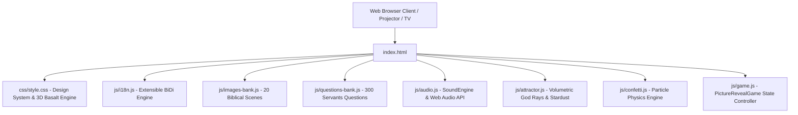

# 🏛️ System Architecture & Engineering Specifications
## أسرار ألواح الهيكل | مسابقة كشف الصورة الكتابية (Temple Codex Edition)
**Version:** 5.9.0  
**Classification:** Offline-First Zero-Dependency Web Application (Single-Page Architecture)

---

## 1. Architectural Overview & Design Philosophy

The application is engineered as a high-fidelity, zero-dependency, client-side web application designed for high-stakes carnival booths, church conferences, and youth conventions. It requires no active backend server, internet connection, or build compilation step to execute in production.



### Core Architecture Tenets:
1. **Offline-First Resilience:** Runs entirely from local storage or static CDN/GitHub Pages without external runtime API calls.
2. **Deterministic State Synchronization:** All visual slab states, question pool extractions, score records, and audio ducking curves are synchronized deterministically through `PictureRevealGame`.
3. **Cross-Platform Multi-Viewport Support:** Dynamic Viewport Heights (`100dvh`), iOS notch/Dynamic Island safe-area avoidance (`env(safe-area-inset-*)`), and min 44×44px touch targets.
4. **Strict Textual Audit (Zero Giveaways):** Questions undergo automated linguistic and structural audits to guarantee uniform option lengths, zero stem overlap, and balanced correct answer indices (25% across 1, 2, 3, 4).

---

## 2. Component Hierarchy & Module Breakdown

| Module | Primary Responsibility | Key Interfaces & Lifecycles |
|---|---|---|
| **`PictureRevealGame`** (`js/game.js`) | Central state machine, DOM event coordination, board rendering, question lifecycle, moderator controls, keyboard routing. | `init()`, `startGame()`, `handleTileClick(i)`, `handleOptionSelection(btn, isCorrect)`, `applyOutcomeAndReturnToBoard()`, `revealFullImage()`, `jumpToScene(id)`. |
| **`I18nEngine`** (`js/i18n.js`) | Dynamic localization and bi-directional text layout (`rtl` vs `ltr`) supporting Arabic (Smith & Van Dyck), English (NKJV), or side-by-side Bilingual mode. | `setMode('ar'\|'en'\|'both')`, `toggleLanguage(lang)`, `formatField(obj)`, `formatVerse(obj)`, `formatReference(obj)`, `getPlainText(obj)`. |
| **`SoundEngine`** (`js/audio.js`) | Procedural Web Audio API sound effect synthesis (bass impact, angelic chimes, fail drums, brass fanfare) and soundtrack audio ducking. | `playTileShatter()`, `playChime()`, `playFailDrum()`, `playWinFanfare()`, `duckToGameVolume()`, `unduckToWelcomeVolume()`, `setGameVolume(vol)`. |
| **`AttractorEngine`** (`js/attractor.js`) | High-framerate HTML5 Canvas renderer for the welcome screen featuring 3D volumetric god rays, breathing temple crest, and 90 floating interactive stardust particles. | `start()`, `stop()`, `resize()`, `drawGodRays()`, `drawParticles()`. |
| **`ConfettiEngine`** (`js/confetti.js`) | 2D canvas particle physics system for victory celebrations simulating gravity, drag, angular spin, and gold/ruby paper fluttering. | `burst(count)`, `update()`, `clear()`. |

---

## 3. Finite State Machine (Game Lifecycle)

The entire user and moderator journey flows through a strictly managed finite state machine that guarantees outcome persistence and prevents race conditions:

```mermaid
stateDiagram-v2
    [*] --> WelcomeScreen: App Initialized
    WelcomeScreen --> GameBoard: Click 'ابدأ التحدي' / Space / Enter
    
    state GameBoard {
        [*] --> SlabsCovered: 3-3-3 Difficulty Shuffled
        SlabsCovered --> QuestionModal: Contestant Selects Tile [1-9]
        
        state QuestionModal {
            [*] --> CountdownRunning: Timer (15s-120s or ∞)
            CountdownRunning --> AnswerChosen: Option Clicked [1-4]
            CountdownRunning --> TimedOut: Seconds = 0
            TimedOut --> AnswerChosen: Contestant Selects After Gong
            
            state AnswerChosen {
                [*] --> PendingOutcome: Buttons Locked & Feedback Shown
                PendingOutcome --> RevelationCard: Verse & Scripture Unsealed
            }
        }
        
        QuestionModal --> SlabsCovered: Commit Outcome ('revealed' or 'failed')
        SlabsCovered --> FullRevealStage: Reveal Image / Space
    }

    state FullRevealStage {
        [*] --> WinTheaterOverlay: Fanfare & Fullscreen Confetti
        WinTheaterOverlay --> MinimizedBoard: Click 'معاينة اللوحة'
        MinimizedBoard --> WinTheaterOverlay: Click 'عرض بطاقة الحدث'
        WinTheaterOverlay --> GameBoard: Click 'المشهد التالي' (Next Scene)
    }

    GameBoard --> WelcomeScreen: Click Home Icon (Return Home)
```

---

## 4. Data Models & Schemas

### 4.1 Biblical Scene Specification (`PICS_DATA`)
Each of the 20 biblical scenes in `js/images-bank.js` is structured with dual-language references and full scripture verses:

```typescript
interface BiblicalScene {
  id: number;                          // 1 to 20
  image_url: string;                   // Relative path: 'assets/imgX.jpg'
  correct_answer: {
    ar: string;                        // Arabic scene title (e.g., 'موسى وعبور البحر الأحمر')
    en: string;                        // English scene title (e.g., 'Moses Crossing the Red Sea')
  };
  reference: {
    ar: string;                        // Arabic biblical reference (e.g., 'خروج 14: 21-22')
    en: string;                        // English biblical reference (e.g., 'Exodus 14:21-22')
  };
  verse_text: {
    ar: string;                        // Full Arabic scripture from Smith & Van Dyck
    en: string;                        // Full English scripture from New King James Version (NKJV)
  };
}
```

### 4.2 Curated Servant Question Specification (`QUESTIONS_BANK`)
Each of the 300 curated questions in `js/questions-bank.js` enforces strict bilingual parity and zero word overlap:

```typescript
interface ServantQuestion {
  id: number;                          // 1 to 300
  level: 1 | 2 | 3;                    // 1: Advanced ✦, 2: Deep ✦✦, 3: Mastery ✦✦✦
  question: {
    ar: string;                        // Arabic question text (Smith & Van Dyck terminology)
    en: string;                        // English question text (NKJV terminology)
  };
  options: {
    ar: [string, string, string, string]; // 4 balanced Arabic options without parenthetical hints
    en: [string, string, string, string]; // 4 balanced English options without Arabic characters
  };
  correctIndex: 0 | 1 | 2 | 3;         // Balanced ~25% distribution across all 4 positions
  reference: {
    ar: string;                        // Arabic Bible book, chapter, and verse
    en: string;                        // English Bible book, chapter, and verse
  };
  verse: {
    ar: string;                        // Full Arabic Van Dyck proof-text
    en: string;                        // Full English NKJV proof-text
  };
}
```

---

## 5. Concurrency, Timing & Security Hardening

### 5.1 Image Loading Sequence Guard (`imageLoadSequence`)
To resolve race conditions when moderators rapidly switch scenes, every image request increments a sequence token:
```javascript
const currentSequence = ++this.imageLoadSequence;
// Async image callbacks only resolve if sequence has not been superseded:
img.onload = () => {
  if (currentSequence === this.imageLoadSequence) {
    img.style.display = 'block';
    canvas.style.display = 'none';
  }
};
```

### 5.2 Wall-Clock Delta Timer (Mobile Background Resilience)
Mobile browsers throttle background `setInterval` timers. The countdown engine uses wall-clock timestamps:
$$\text{remainingSeconds} = \max\left(0, \left\lceil \frac{T_{\text{end}} - \text{Date.now}()}{1000} \right\rceil\right)$$
Sampling at 250ms guarantees zero missed seconds, instant catch-up upon foregrounding, and zero drift.

### 5.3 Outcome Enforcement on Modal Close
If an option is chosen, closing the question screen via `Escape` or the close icon (`✕`) forcibly invokes `this.applyOutcomeAndReturnToBoard()`, preventing contestants from avoiding penalties for incorrect answers.

---

## 6. Audio Ducking & Procedural Synthesis Pipeline

The sound engine orchestrates procedural audio synthesis through the Web Audio API alongside an HTML5 background soundtrack:

```
[HTML5 Audio Track] ──> [Gain Node] ──> [Master Output]
                           │
    Welcome Screen: Volume = 45% (0.45)
    In-Game Arena:  Volume = 20% (0.20) [Automated Smooth Ducking]
    User Custom:    Volume = Scaled by Slider (0% - 100%)

[Web Audio Context] ──> [Oscillators / White Noise] ──> [Biquad Filters] ──> [Audio Destination]
    ├── Stone Slab Shatter (Sub-bass triangle wave + low-pass noise rumble)
    ├── Celestial Answer Harp (Arpeggiated high-sine chords)
    ├── Penalty War Drum (Pitch-swept 90Hz to 30Hz exponential drop)
    └── Royal Victory Brass (C-Major triadic fanfare)
```

---

## 7. Multi-Platform Viewports & CSS System

- **Safe Area Insets:** Integrated into `:root` (`--sat`, `--sar`, `--sab`, `--sal`) to eliminate notch and Dynamic Island interference on iPhone and modern Android devices.
- **Dynamic Viewport Heights:** Employs `100dvh` with `100vh` fallback, ensuring bottom toolbars never get hidden by mobile browser address bars.
- **Touch Targets:** Coarse pointer media queries enforce minimum 44×44px interactive areas.
- **Accessibility:** High-contrast golden `:focus-visible` outlines guarantee seamless keyboard navigation across all interactive elements.
