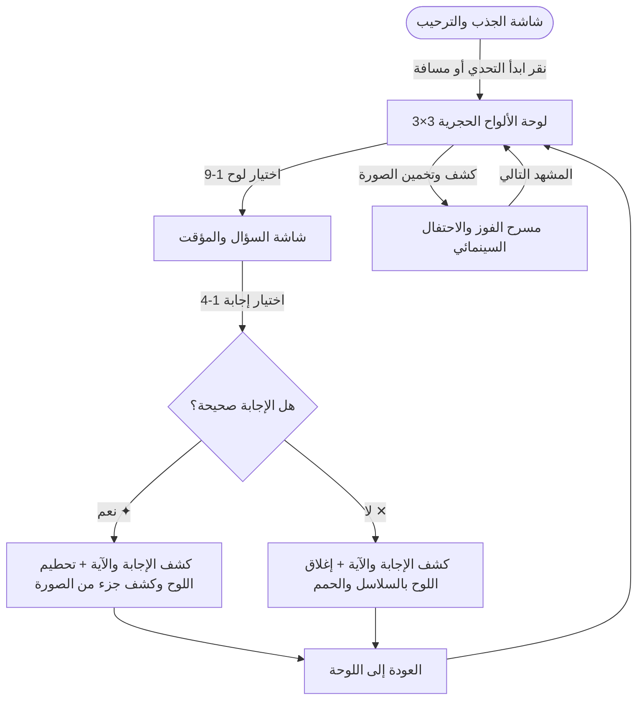

# أسرار ألواح الهيكل | مسابقة كشف الصورة الكتابية
### Temple Codex Edition — Bilingual Servants Bible Picture Reveal (v5.12.0)

[](tests/game.test.js)
[](js/version.js)
[](ARCHITECTURE.md)
[](package.json)

تطبيق ويب سينمائي تفاعلي (Single-Page Application) فائق الجودة مخصص لأكشاك الكرنفال ومسابقات الخدام ومؤتمرات الشباب الكنسية، يعمل محلياً بالكامل (**Offline-First**) بدون الحاجة لأي خادم أو اتصال بالإنترنت.

---

## 🎮 دورة حياة اللعبة (Gameplay Flow)



---

## 🌟 أبرز مميزات النظام (Core Capabilities)

### 1. المحرك متعدد اللغات القابل للتوسع (`js/i18n.js`)
- **العربية فقط (Arabic):** نصوص وترجمات كاملة بالاتجاه الطبيعي `rtl` وفق ترجمة سميث وفاندايك (Smith & Van Dyck).
- **الإنجليزية فقط (English):** نصوص وترجمات كاملة بالاتجاه الطبيعي `ltr` وفق ترجمة الملك جيمس الحديثة (NKJV - New King James Version).
- **الوضع ثنائي اللغة (Bilingual Mode):** عرض اللغتين معاً جنباً إلى جنب أو في صفوف متتابعة لتنظيم المسابقات المشتركة.
- تبديل فوري مستقل عبر أزرار الترويسة وشاشة الترحيب دون إعادة تحميل الصفحة.

### 2. بنك أسئلة الخدام المدقق (300 سؤال أصيل مع نصوص الآيات)
- مقسم بدقة إلى 3 مستويات صعوبة معرفية صلبة:
  - **100 سؤال للمستوى الأول (متقدم ✦):** أحداث كتابية وتاريخية عميقة.
  - **100 سؤال للمستوى الثاني (عميق ✦✦):** تفاصيل أسفار وأرقام وأنساب دقيقة.
  - **100 سؤال للمستوى الثالث (فائق الصعوبة ✦✦✦):** أسئلة متخصصة للخدام والدارسين.
- **تدقيق لغوي صارم (Zero Giveaways):** خلو كافة الخيارات من الأقواس التفسيرية `(...)`، وتماثل أطوال التراكيب الأربعة، وعشوائية موضع الإجابة الصحيحة بنسبة متوازنة (25% لكل من 1، 2، 3، 4).
- ظهور **بطاقة كشف الإجابة والآية الكاملة** بعد كل إجابة موثقة بالشاهد ونصوص الآيات الكاملة من الفاندايك و NKJV دون إغلاق تلقائي متسرع.

### 3. التوزيع العشوائي الديناميكي للصعوبات (3-3-3 Dynamic Randomization)
- يخلط النظام عشوائياً 3 مربعات متقدمة (✦)، 3 مربعات عميقة (✦✦)، و 3 مربعات فائقة (✦✦✦) عبر المواضع التسعة في كل جولة جديدة لمنع حفظ مواقع الصعوبات وزيادة التشويق.

### 4. المؤقت التنازلي التكيفي ونمط الوقت اللانهائي (Wall-Clock Delta Timer)
- شريحة تحكم مدمجة لتحديد وقت السؤال من 15 إلى 120 ثانية، مع حفظ التفضيل محلياً في المتصفح.
- **نمط بدون وقت (∞ Unlimited):** لإيقاف المؤقت تماماً وإتاحة النقاش المعرفي الهادئ دون أي ضغط زمني.
- **حساب زمني حقيقي بالساعة:** مناعة كاملة ضد تجمد المؤقت أو انحرافه عند خمول المتصفح أو الانتقال بين النوافذ على هواتف iOS و Android.

### 5. مسرح كشف الصورة الكامل والاحتفال السينمائي (Fullscreen Win Theater)
- شاشة فخمة متكاملة تقسم العرض إلى معرض للصورة المكتملة الفخمة، وسجل للشاهد والآيات المباركة.
- إمكانية خفض بطاقة الفوز لمعاينة اللوحة (`معاينة اللوحة`) وإعادتها متى رغب المشرف.

### 6. الصوتيات السينمائية ومحرك خفض الموسيقى (SoundEngine & Audio Ducking)
- مؤثرات تكتيكية مولدة حياً عبر Web Audio API (ارتطام الألواح، قيثارة الإجابة، طبل الخطأ، وأبواق الفوز).
- مسار موسيقى كرنفالية تصويرية في الخلفية مع خاصية خفض الصوت التلقائي السلس (**Audio Ducking**) إلى 20% داخل اللعبة للتركيز، وعودتها إلى 45% في شاشة الترحيب.

### 7. التوافق الشامل وتجربة الاستخدام (Multi-Platform UI/UX)
- دعم الشاشات ذات النتوء (Notch/Dynamic Island) والشريط السفلي عبر حساب المساحات الآمنة (`env(safe-area-inset-*)`).
- اعتماد الارتفاع الديناميكي `100dvh` لمنع اختفاء الأزرار السفلية عند ظهور أشرطة عنوان المتصفحات المحمولة.
- تطبيق معيار WCAG 2.5.5 / Apple HIG لأهداف لمسية لا تقل عن 44×44 بكسل مع استجابة حسية فورية بالضغط (`:active`).
- مؤشرات تركيز ذهبية بارزة `:focus-visible` متوافقة مع معايير WCAG 2.1 AA للتنقل بلوحة المفاتيح.

---

## ⌨️ لوحة تحكم المفاتيح السريعة (Keyboard Controller)

| المفتاح | الوظيفة |
|---|---|
| **`1` إلى `9`** | فتح البلاطة المقابلة رقمياً (1 إلى 9) مباشرة على اللوحة |
| **`1` إلى `4`** أو **(`A`, `B`, `C`, `D`)** | اختيار الإجابة المقابلة داخل شاشة السؤال |
| **`Space` (المسافة)** | كشف الصورة بالكامل وإطلاق النفير ومقذوفات الزينة |
| **`N` (أو حرف `ى`)** | الانتقال إلى المشهد التالي من بنك المشاهد العشرين |
| **`P` (أو حرف `ح`)** | إظهار/إخفاء نافذة عين المشرف لمعاينة الإجابة والشاهد سراً |
| **`T` (أو حرف `ف`)** | تشغيل أو إيقاف المؤقت التنازلي للسؤال |
| **`Escape`** | إغلاق شاشة السؤال واعتماد النتيجة المعلقة بأمان دون فقدان البيانات |

---

## 🚀 كيفية التشغيل السريع (Offline Execution)

1. حمّل أو استنسخ المستودع محلياً:
   ```bash
   git clone https://github.com/BishoyN/Game2.git
   ```
2. انقر نقراً مزدوجاً على ملف `index.html` لفتحه في أي متصفح ويب حديث (Google Chrome, Microsoft Edge, Safari, Firefox).
3. التطبيق يعمل فوراً محلياً بنسبة 100% دون الحاجة إلى تثبيت Node.js أو تشغيل أي خادم محلي!

---

## 🧪 ضمان الجودة والاختبارات الآلية (Quality Assurance)

المشروع مزود بجناح اختبارات متكامل وموثق يضم **78 اختباراً آلياً** موزعة عبر 19 جناحاً:

```bash
# تشغيل جناح الاختبارات الآلية الشاملة
npm test

# فحص سلامة الأكواد والبيانات وتطابق الشواهد
npm run lint

# فحص جاهزية وتكامل ملفات الإنتاج
npm run build
```

---

## 📄 الوثائق الهندسية والمواصفات
- **المواصفات التقنية والمعمارية:** [ARCHITECTURE.md](ARCHITECTURE.md)
- **وثيقة متطلبات النظام:** [REQUIREMENTS.md](REQUIREMENTS.md)
- **سجل الإصدارات والتغييرات:** [CHANGELOG.md](CHANGELOG.md)
